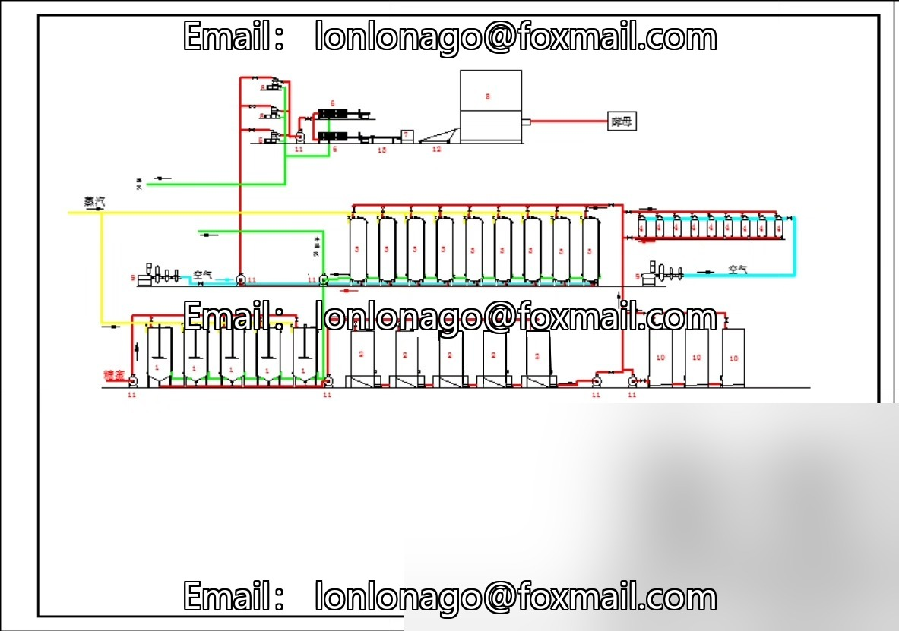
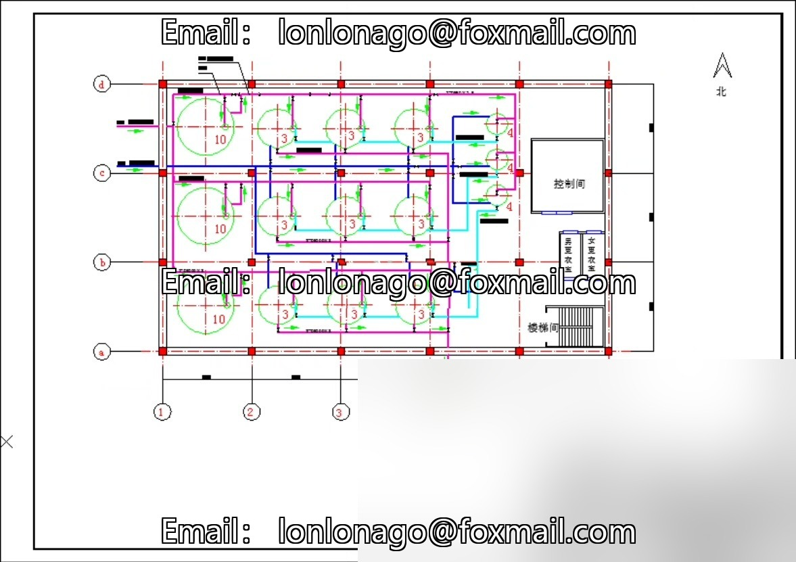
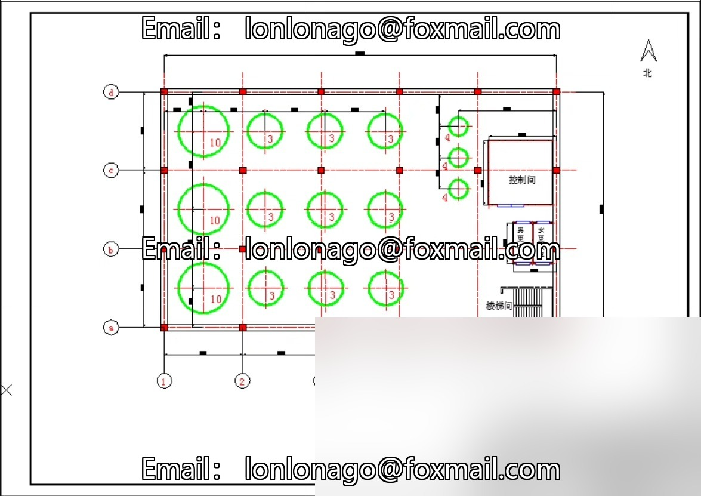
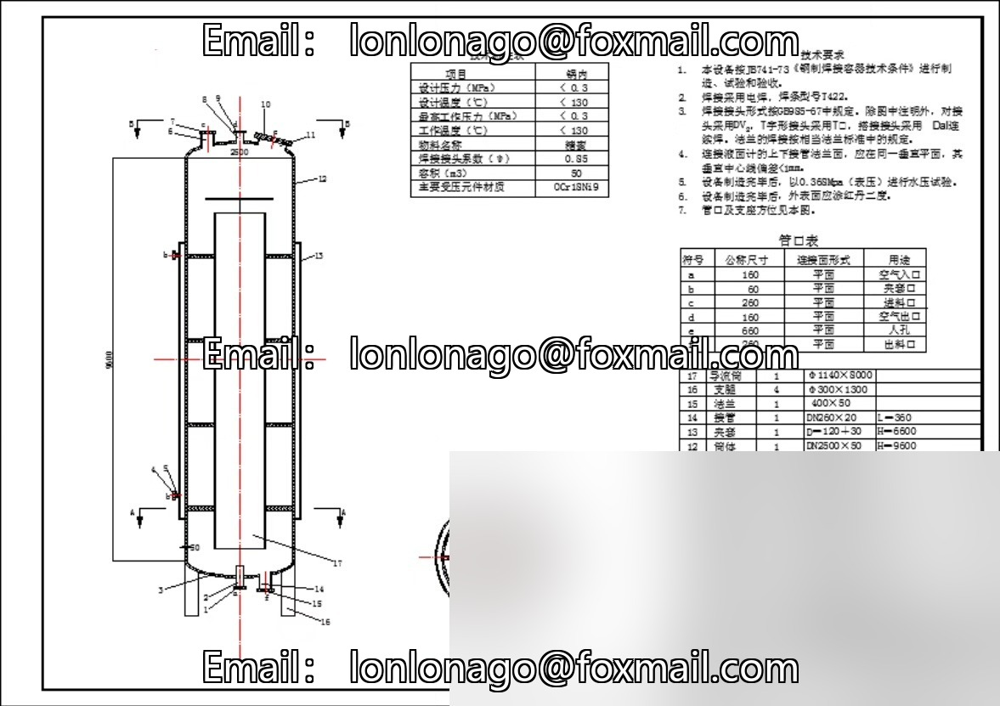

# Active dry yeast workshop CAD design

## Body

1. Active dry yeast workshop CAD design: design of active dry yeast production workshop, design of active dry yeast production workshop, design CAD of active dry yeast production workshop.
401 This design is the workshop design for producing active dry yeast based on sugar molasses; first, it is necessary to clarify the equipment required for active dry yeast production, then the equipment is sorted according to the order of material processing, thereby obtaining the process flow of sugar molasses fermentation to produce active dry yeast.
According to the output of active dry yeast and the order of materials passing through equipment, material and heat balances are calculated.
Using the data obtained from calculations, equipment selection is performed, thus selecting equipment that is technically advanced, economically reasonable, and suitable for this process.

Further, based on the specifications of the equipment and the characteristics of the production process, the workshop layout and pipeline layout shall be arranged.

The design covers workshop layout, equipment selection, pipe layout, process flow and technical requirements for active dry yeast production.

<!-- AI_ENRICHED -->

## Images

## Payment

Here is a pay link on Stripe ( https://buy.stripe.com/3cs8yP7sY87d0vu9AB ). Please contact me lonlonago@foxmail.com after funding $89, and I will send you a complete data files , thank you!

